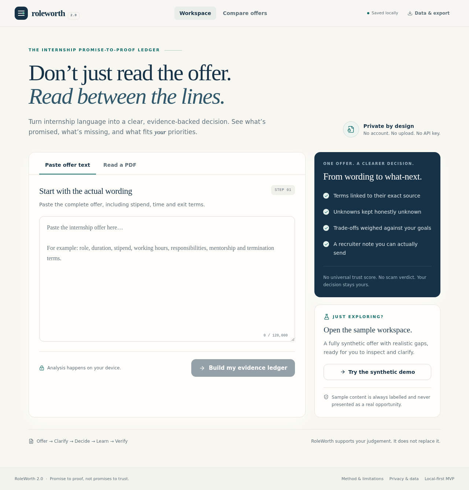

# RoleWorth 2.0

**The Internship Promise-to-Proof Ledger**

Know what was promised. Clarify what is missing. Track what you actually receive.

RoleWorth helps a student evaluate an internship offer against personal goals and constraints without creating an account or sending the offer to a third party. It is an evidence and reflection tool, not an employer rating, fraud detector or legal adviser.



*Real screenshot of the local app. The sample workspace uses clearly labelled synthetic data; see `docs/screenshots/decision.png` for the decision brief.*

## Implemented workflow

**Offer → Clarify → Decide → Learn → Verify**

- Paste offer text or extract a text-based PDF locally with PDF.js; edit the extracted text before analysis.
- Review 12 term categories with exact source excerpts and explicit provenance: **Explicit in offer**, **Provided by you**, **Inferred**, **Unknown**, or **Independently verified** (with a user-supplied source).
- Correct or reject extracted terms without changing the original source text.
- Set target role, skills, preferred work, available hours, minimum stipend, mentorship preference and non-negotiables; see transparent alignment, conflicts and missing information recalculate.
- Draft and copy a concise recruiter message from the current evidence gaps.
- Record a recruiter reply, explicitly link it to terms, and inspect immutable before/after **Promise Delta** snapshots.
- Create, edit, postpone, complete and delete personal learning milestones; record dated outcomes separately from employer commitments.
- Compare two saved offers while retaining unknowns and keeping their evidence separate.
- Download an escaped Markdown report or schema-versioned JSON backup; import validated JSON and recalculate its assessment.
- Use clearly labelled synthetic demo offers, local persistence, delete-current-offer and reset-workspace controls.

## Quick start

Requirements: Node.js 20.19+ (or a supported newer LTS release) and npm.

```bash
npm ci
npm run dev
```

Open the local URL printed by Vite. The development server binds to `0.0.0.0` for the workspace preview. No environment variables, API keys, account or database are required.

### Production build

```bash
npm run lint
npm run type-check
npm run test
npx playwright install --with-deps chromium # first browser-test setup
npm run test:e2e
npm run build
npm run test:bundle
npm run preview
```

The production output is `dist/`. `npm run preview` serves that build locally; it is not a public deployment.

## Try the synthetic demo

Select **Try the synthetic demo** on the intake screen. The sample is invented for product evaluation and is labelled throughout the workspace. It includes an unresolved mentorship term so you can:

1. Inspect the offer-backed terms and their source excerpts.
2. Open **Clarify**, review the generated question and edit/copy the message.
3. Use **Insert a clearly labelled synthetic reply for the demo**, or enter your own reply.
4. Link the reply to mentorship and record the specific new value.
5. Inspect the before/after Promise Delta and the unresolved questions.
6. Open **Learn** or **Verify** to record personal goals and actual outcomes.
7. Optionally open **Compare offers** and load the second synthetic offer to compare the records without mixing their evidence.
8. Open **Data & export** and download the Markdown decision report.
9. Choose **Reset entire workspace**, confirm the reset, and verify that the initial intake returns. Select **Try the synthetic demo** again to replay the flow.

For a recording, reset first or use a fresh browser profile so the walkthrough starts from the same empty intake state. No AI credentials or network service are required.

## Architecture

React + TypeScript + Vite + Tailwind CSS, with Lucide icons, Zod validation and PDF.js. The app is a static, local-first SPA:

```text
src/
├── app/App.tsx                 # workspace state, navigation and shell
├── components/ui.tsx           # shared buttons, badges, modal and states
├── features/                   # intake, ledger, decision, clarification,
│                               # learning, comparison and data controls
├── lib/                        # deterministic rules, PDF, storage and exchange
├── types/index.ts              # canonical domain types
└── tests/                      # domain and React integration tests
```

The canonical product, design, architecture, data and service documents live in [`docs/`](docs/). There is one assessment engine and one domain model; there is no backend or optional AI path in this release. PDF.js is loaded only when PDF intake is selected, and `npm run test:bundle` checks that boundary against the production manifest.

## Privacy and trust boundaries

- Offer text and PDF parsing happen in the browser. The app has no external API, analytics, recruiter integration or remote database.
- Uploaded PDF binaries are not persisted. Pasted/extracted text becomes part of a local ledger only after you choose to build it.
- Saved records use the browser’s `localStorage` under `roleworth.workspace.v1`. They do not follow you to another browser or device.
- Export and import are user-initiated local file actions. Imported data is schema-validated before entering state; imported assessments are recalculated from terms and priorities.
- “Independently verified” is only a record of a source you say you inspected. RoleWorth does not independently check that source or certify an employer.
- Unknown means the available evidence does not establish a term. It does not mean the term is absent, false or evidence of wrongdoing.
- Use the reset control on shared devices. Export a backup first if you need to keep the record.

## PDF support and limitations

The PDF flow accepts PDF files up to 8 MB and 40 pages. Text-based PDFs produce editable text. Corrupt, empty, password-protected, oversized and no-text files receive actionable errors. Scanned/image-only PDFs require manual paste or typing; **OCR is not implemented**. Complex layouts and unusual fonts can still produce imperfect extraction, so source review is required.

The app intentionally does not include OCR, employer scraping, automated verification, a fraud probability, universal trust score, salary prediction, accounts, payments or autonomous recruiter contact. Reports are Markdown and JSON; PDF report export is not included.

## Checks

The configured checks are:

```bash
npm run lint       # ESLint
npm run type-check # strict TypeScript
npm run test       # Vitest domain + React integration tests
npm run test:e2e   # Playwright Chromium workflow + mobile/privacy checks
npm run build      # TypeScript build + Vite production bundle
npm run test:bundle # Assert PDF intake stays out of the initial static graph
npm audit          # Check the locked dependency tree for known vulnerabilities
# Optional: run the browser suite against an already-running production preview
PLAYWRIGHT_BASE_URL=http://127.0.0.1:4173 npm run test:e2e
```

See [`RELEASE_REPORT.md`](RELEASE_REPORT.md) for the checks actually executed during this build and any manual checks still required. Do not infer deployment or browser coverage from the presence of a script.

## Deployment

The static deployment target is **Netlify**. The included [`netlify.toml`](netlify.toml) runs `npm run build`, publishes `dist`, and provides the SPA fallback.

1. Push this repository to GitHub.
2. In Netlify, choose **Add new site → Import an existing project** and select the repository.
3. Confirm build command `npm run build` and publish directory `dist`.
4. Deploy, then verify the generated HTTPS URL manually: intake, a text PDF, local persistence after refresh, PDF worker loading, export/import and mobile layout.
5. Record the public URL only after it has actually been opened and checked.

No public deployment has been performed by this repository setup. There are no required environment variables.

## Contributing

Read [`docs/AGENTS.md`](docs/AGENTS.md) before changing the domain or privacy boundaries. Keep changes small, preserve provenance, add regression tests for rule changes, and report checks honestly. See [`CONTRIBUTING.md`](CONTRIBUTING.md).

No open-source license has been selected or added.
